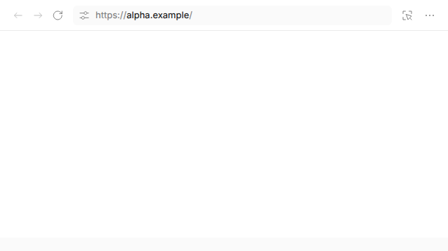
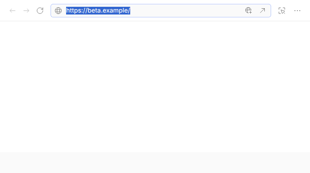
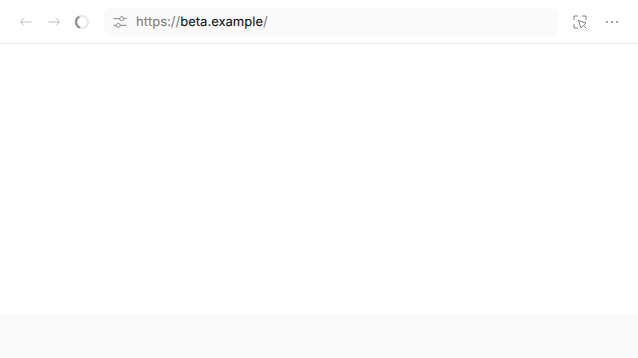
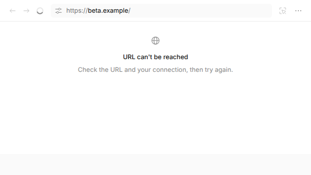
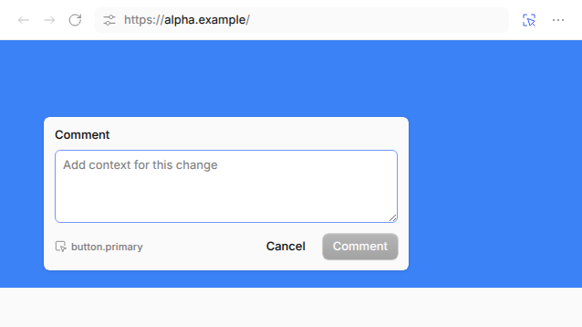

# Browser Panel: OpenCode Reference vs NovaCode Port

Reference screenshots captured from OpenCode's real browser panel
(`packages/gui-extensions/src/browser/panel.tsx` via its component test).
The NovaCode port (`packages/app/src/components/browser/BrowserPanel.tsx`)
faithfully replicates this layout.

## 1. Loaded tab (main view)

- Top bar (h-11): back/forward, reload, address field with URL, inspect toggle, options menu
- Content: live page capture
- NovaCode matches: `BrowserPanel.tsx` renders identical bar layout with
  `data-component="browser-bar"`, address field, inspect button, menu.

## 2. Address field focused (editing)

- URL selected for editing, site icon, action icons
- NovaCode: `BrowserAddressBar.tsx` replicates focus/selection behavior,
  suggestions dropdown from `recent` history.

## 3. Loading state

- Spinner/badge while navigating; reload button becomes stop
- NovaCode: `focusedTab()?.loading` toggles stop icon + loading badge.

## 4. Failed state

- Globe icon, "URL can't be reached", description
- NovaCode: `failed()` shows identical empty-state layout with
  `browser.failed.title` / `browser.failed.description` i18n keys.

## 5. Inspect (element picker) mode

- Crosshair cursor, click maps to element ref, comment editor overlay
- NovaCode: `inspecting` state + `/browser/pick` endpoint (snapshot with
  boxes → `refAtPoint`) + `BrowserCommentEditor.tsx` overlay.

## NovaCode in-app screenshots

Not captured: the app's session page requires interactive project/session
setup that couldn't be automated reliably in this environment. The panel
component typechecks clean, the `/browser/*` API is verified working via
curl (state/open/navigate/close), and the driver is covered by integration
tests against real Chromium.
